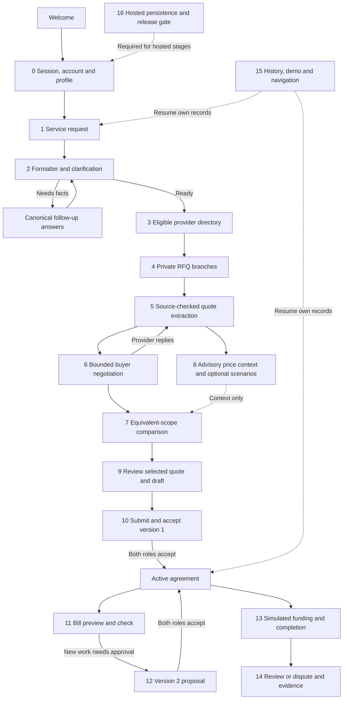

# Wasit business and AI pipeline

Status recorded on 7 November 2026. This document explains the current pipeline, the state of every stage, the additional cost-agreement features, and the difference between tested local behavior and a hosted release.

The main promise is **Clear quotes. No surprise extras.** Wasit helps a customer compare equivalent work, negotiate within explicit instructions, agree on immutable terms, and approve changes before extra work becomes payable.

## 1. Status conventions

- **Done locally:** implemented behavior has relevant domain, HTTP or browser evidence. This does not imply a real provider, real payment or hosted database.
- **Partial:** code exists, but an integration, scheduled executor, visual check or hosted check remains.
- **Blocked externally:** a required external account/service step is unavailable to the running agent.
- **Outside scope:** intentionally excluded from the approved build; it is not an unfinished promise.

Current release gate: the public UI and API are deployed, OpenAI credentials are configured, and local login works. Hosted business routes require PostgreSQL. Neon Free still requires human marketplace acceptance and provisioning. Until that gate is complete, production business actions return HTTP 503 with storage_not_configured.

The current shared-screen alignment is being verified separately from business logic. Older browser results remain historical evidence; renewed flow checks are required for changed screens.

## 2. End-to-end flow

A rejection, fallback or incomplete quote does not authorize extra work. Selecting a provider does not activate an agreement. Reading a bill does not approve it. An active version changes only after both roles accept the same new version.

## 3. Stage overview

| Stage | Purpose | Implementation and evidence | Remaining gate |
|---|---|---|---|
| 0 | Session, named account and profile | Done locally: opaque sessions, registration/login, scrypt, account switching, private profile and weights. Eighteen account/auth HTTP checks pass; renewed browser onboarding runs. | Hosted PostgreSQL and final shared-flow release. |
| 1 | Request composer | Done locally: free text, examples, repeat-last, service/location/time, private cap, optional authorized target and priorities. | Final visual comparison and hosted request creation. |
| 2 | Formatter and follow-up | Done locally: five-category job, English canonical answers, explicit hard facts, one owned clarification child and replay handling. | Broader real-language coverage remains a quality limit. |
| 3 | Provider discovery | Done locally: category, consent, area/radius and opening-hour overlap; at most five branches. | Directory contains synthetic demo businesses, not verified commercial supply. |
| 4 | Private RFQ and chat | Done locally: scoped RFQ, private branches, idempotent messages, expiring human invitation, QR/link and timeout. | Hosted human-link test after database provisioning. |
| 5 | Quote extraction and source checks | Done locally: revisions, integer prices, exact sources, quantities/units, withdrawal/invalidation and model fallback. | Larger independent message set; no unsupported-unit inference. |
| 6 | Buyer negotiation | Done locally: code-computed actions/citations, bounded rounds, template-rendered outgoing text and provider simulation. | Real commercial negotiation is not claimed. |
| 7 | Comparison and explanation | Done locally: equivalent groups, complete required costs, weighted ranking, reasons and exclusions. | Renewed score/deck visual checks and hosted smoke. |
| 8 | Reference context and planning | Done locally: sourced observations, quality thresholds, exact-scope lookup and one optional item per scenario. | Most reference groups correctly have insufficient evidence. |
| 9 | Selection and draft review | Done locally: current eligible revision, no unprocessed provider change, private spending limit and immutable draft. | Final four-step review visual check. |
| 10 | Bilateral version activation | Done locally: explicit submission, two role acceptances, digest, stale/replay protection and atomic activation. | Hosted cross-request verification. |
| 11 | Bill preview and checking | Done locally: editable image draft, explicit confirmation, active-version check and cumulative line quantities. One synthetic three-line image was read in a live test. | Real-bill quality is not established. |
| 12 | Additional work and version 2 | Done locally: selected-provider sources, explicit lines/limit, pending version, both acceptances and unchanged history. | Hosted stale/concurrent checks. |
| 13 | Simulated funding, work and release | Done locally for hold/top-up/refund, provider completion and customer release. Due-settlement service is tested. | A recurring 72-hour settlement executor is not deployed; reads never release funds. |
| 14 | Disputes, evidence and reviews | Done locally: version-bound dispute, explicit provider response, rework/refund simulation, review and one reply. | No real mediator or real payment processor is connected. |
| 15 | History, demo and route UX | Partial: owner history, canonical routes, welcome return, separate reset, presentation controls and shared-shell alignment are implemented; renewed browser checks continue. | Complete the combined route, keyboard, viewport and visual audit. |
| 16 | Production hosting and persistence | Partial: Vercel public UI/API and server secrets configured. | Neon acceptance/provisioning, live PostgreSQL verification and hosted end-to-end rehearsal. |

## 4. Detailed stages

### Stage 0 - Enter a private workspace

**Input:** an existing session, explicit demo-session action, or named registration/login. A profile contains display_name, location_label, default_category and three weights: price, slot and trust.

**Process:** the server creates or rotates an opaque cookie and a corresponding CSRF token. Named passwords use salted scrypt; normalized email is unique. Persistent attempt limits apply to authentication. Registration can adopt the customer's current unlinked demo actor so that their own work is preserved. Switching accounts invalidates the previous cookie and loads the new actor's records.

**Output and storage:** sessions, accounts, profiles and auth_attempts. Profile GET returns null until setup is actually saved; registration alone does not pretend onboarding is complete.

**Boundary:** provider access uses its own branch bearer context and a chrome-less screen. It does not receive the customer's cookie, spending limits, account email or history.

### Stage 1 - Describe the service

**Input:** everyday Indonesian or English text, optionally supported by visible form choices. The current categories are AC service, washing-machine service, plumbing, electrical service and home cleaning.

**Process:** the composer preserves the draft, supports examples and repeat-last, and collects the maximum budget explicitly. A preferred target becomes a public negotiation citation only with target_authorized=true. Saved location and priorities can prefill; a saved service suggestion must not silently override a different explicit service in the request text.

**Output:** create_request input. The cap and target are separate values. An approximate amount is not silently converted into a hard spending cap.

### Stage 2 - Format and clarify

**Input:** request text, supplied fields and canonical follow-up answers.

**Process:** deterministic parsers establish category, scope, units, location, schedule/window, private cap, target and weights. An optional model may suggest only independently supported facts. Missing or ambiguous facts create clear follow-up questions rather than invented values.

**Output and storage:** a ready job or needs_clarification request with questions. Clarification creates one owned child request and preserves the original. Replaying the same clarification returns that child.

**Boundary:** schedule labels use English and WIB; stored times are epoch milliseconds or the designated ISO window. Money is integer Rupiah. Model output never authorizes a target.

### Stage 3 - Discover eligible providers

**Input:** a ready job.

**Process:** check category, explicit consent, service radius and opening hours against the requested window. Results are bounded to at most five providers. Synthetic scripted scenarios are visibly labeled and can use explicit demo discovery behavior.

**Output and storage:** eligible providers, skipped reasons and persisted discovery work. The current seed has two script personas and one human-playable business per category.

**Boundary:** the provider's private floor and price list belong to that provider. They are not a market-price reference book or a competitor's evidence. Seed ratings and geometry remain labeled demo assumptions.

### Stage 4 - Open private RFQ branches

**Input:** the eligible providers and public job fields.

**Process:** create one branch per provider and send a scoped RFQ with category, work, quantity, location and schedule. The RFQ omits the private cap and customer account identity. Message retries use a stable client_message_id and store one message.

A human branch has a 32-byte-strength secret grant, stored as a hash with a nonce/expiry. Its invitation uses a URL fragment, then memory and Authorization: Bearer; the fragment is removed. GET link reads an existing grant; an explicit owner action can rotate it. Reset revokes it.

**Output:** private branch chats with script/model/human labels. The human response deadline is persisted at 90 seconds. A user can take over one branch and later return control to Wasit.

**Outside scope:** real WhatsApp transport and phone calls. A displayed communication label does not establish either integration.

### Stage 5 - Extract a source-checked quote

**Input:** one provider message from the authorized branch.

**Process:** associate each catalog item with its own atomic text, quantity, unit, price and exact source snippet. Verify that source_message_id belongs to the same provider branch. The server rejects cross-item price borrowing, unsupported units, conflicting prices and instruction attacks.

The quote distinguishes fixed, included, optional and unknown. Included means explicitly zero; unknown remains null. A newly mentioned item's invalid terms cannot keep its old ready price. A withdrawn appointment invalidates the earlier appointment confirmation. Untrusted message content cannot be hidden by a model returning a shorter, clean-looking snippet.

**Output and storage:** immutable historical quote rows with increasing revisions, a source-message processing marker and a latest quote state: ready, needs_detail or over_budget. Processing the same source again returns its existing quote revision.

**Boundary:** the base quantity must match the requested quantity. Required unresolved work never becomes a comparable zero-cost offer. Previously accepted agreement terms remain unchanged even when a later quote is different.

### Stage 6 - Negotiate within explicit instructions

**Input:** source-checked own quote, comparable current alternatives, branch counters and the customer's instructions.

**Process:** code computes allowed actions and exact available citation amounts. The model can choose an allowed action; it does not invent the outgoing amount. Code renders the final text.

- ask_detail: a supported unresolved detail, with at most three automatic clarifications.
- counter: at most one price counter, using a current equivalent competitor quote or an explicitly authorized target.
- counter_terms: at most one permitted terms request, such as waiving a quoted transport charge.
- close: stop automatic negotiation and pass the actual available information to the customer.

The provider simulation sees its own price list/floor, public job and approved terms only. It does not see the customer's cap or other branches.

**Output:** one validated decision, an honest rules/model engine, source IDs and a persisted next task. Locked agreements do not restart negotiation or alter accepted work.

### Stage 7 - Compare equivalent offers

**Input:** current quotes and the request weights.

**Process:** require complete costs for the requested scope and a confirmed schedule. Group only equivalent category, scope, quantity/unit signature, location and appointment window. Exclude incomplete, over-budget or different-scope quotes with a reason.

The quoted total sums explicit fixed work and fees; optional work never enters ranking as if ordered. A weighted score uses price, schedule fit and trust signals. Demo trust inputs remain labeled assumptions. A model explanation may select only server-supported wording.

**Output:** comparison groups, ranked cards, score parts, reasons and exclusions. View-order controls are not permission to fabricate a better score or conceal incomplete costs.

### Stage 8 - Show advisory price context and optional scenarios

**Input:** an exact reference query or an explicit optional line from the selected quote.

**Process:** source observations carry publisher, URL, collection date, item, unit and narrow scope. A band needs at least five valid observations from at least three distinct publishers. Starting prices, broad ranges, bundled services, unknown units and contradictory observations are excluded.

The current collection has 13 observations across five categories. Only the narrow standard 0.5-1 PK residential AC base-cleaning item has five suitable publisher observations. Its Rp75,000/unit observation band does not establish transport or an all-in final bill. Other groups remain insufficient_data.

Planning shows one quoted optional item at a time: quoted total plus its explicit quantity times unit price. It does not assign a probability, add every optional item together as necessary work, establish a diagnosis, approve work, change ranking or raise the private cap.

### Stage 9 - Select an eligible quote and review a draft

**Input:** branch_id and quote_revision from the current comparison.

**Process:** ownership, category, scope, unit count, appointment and actual arithmetic are rechecked at the service boundary. A caller cannot bypass comparison exclusions by posting an ID directly. A newer unprocessed provider message blocks selection until it is checked.

**Output:** a draft agreement with immutable terms, a public digest and a private spending limit. Selection does not submit, accept, fund or confirm the agreement.

The shared review flow shows the service, exact included/fixed/optional work, schedule/location and the customer's explicit acceptance controls.

### Stage 10 - Activate version 1

**Input:** version_id, terms_digest, expected_active_version_id and role-appropriate acceptance data.

**Process:** submit the draft, then record independent consumer and provider acceptances for that same digest. The consumer acknowledges the exact private limit. The provider receives public terms and boolean acceptance flags, not that limit or the consumer actor ID.

**Output and storage:** one active version only after both acceptances. Replays do not duplicate acceptance. Stale digest/version, wrong actor or a conflicting transition is rejected. Public terms exclude private acknowledgement fields.

The ticket exposes the active public agreement, version history and integrity digest. Share/show-technician views use public agreed information.

### Stage 11 - Read and check the on-site bill

**Input:** manually entered bill rows or a supported bill image.

**Process:** OpenAI image reading is an editable preview. Check file type/size, image signature and structured output. The customer must confirm every label, quantity, unit and amount before submitting bill-checks. An unreadable image uses manual entry; it does not fill a price from agreement text.

The bill check is bound to the expected active version. It aggregates repeated item/unit quantities before comparing them, so splitting an extra quantity across rows cannot evade the check. Included work cannot silently acquire a price.

**Output and storage:** check rows, submitted total and per-line results. The check does not change an agreement, approve a line, create a payment or turn a source-free claim into a provider quote.

The live vision evidence is one independently labeled synthetic three-line image. It is not a general real-bill accuracy claim.

### Stage 12 - Propose and activate version 2

**Input:** a message from the selected provider, explicit quoted candidate lines, current active version and an explicit spending_limit.

**Process:** validate the selected provider's exact sources and supported optional-work candidates. Preserve version 1 while the new draft/pending version is reviewed. If the new committed total exceeds the old cap, the customer explicitly supplies and acknowledges a sufficient new cap.

Example: version 1 commits Rp110,000 under a Rp250,000 cap. A quoted optional Rp150,000 item would make Rp260,000. It is not approved until a new sufficient limit and both role acceptances activate version 2.

**Output:** an active new version after two acceptances; the old version becomes superseded but its terms and acceptances remain immutable. Rejecting the proposal preserves the current active version. A budget increase alone never authorizes work.

### Stage 13 - Simulate funding and work completion

**Input:** an active agreement and an explicit expected_active_version_id.

**Process:** hold the committed amount in the simulation ledger. If a later active version increases the total, show the additional amount due and require a separate top-up. New acceptance is not a payment. Provider completion requires the current version to be funded; customer confirmation releases its simulated funds.

The settlement service checks eligibility after 72 hours only for completed work with no unresolved dispute or pending change. It is tested, but a recurring hosted executor is not currently deployed. A read-only GET never releases funds.

**Output and storage:** version-bound hold, topup, release or refund entries plus funded/done version references. Repeated actions do not duplicate ledger entries. Archived requests reject service mutations even if HTTP authorization happened before reset.

**Outside scope:** transferring or holding real money, digital-wallet processing and escrow guarantees.

### Stage 14 - Handle a problem and close feedback

**Input:** a specific active version, dispute reason, optional requested amount and evidence.

**Process:** the customer opens a version-bound dispute. Both roles can add evidence within the allowed state; the provider explicitly responds to the proposed simulated outcome. Supported policy can return held funds for a no-show, request rework, or retain the active agreement against an unapproved charge. A disagreement is shown as escalated; it does not claim an operational mediator.

Rework retains funds and requires a new completion. Reviews are allowed once after settlement, with one provider reply. A provider sees only its own reviews and quote-completeness feedback.

**Output:** a preserved dispute/evidence history, explicit simulation state and a review tied to the settled work. No arbitrary refund percentage or real-money outcome is invented.

### Stage 15 - Resume, retry, demo and navigate

**Input:** the signed-in actor and an explicit route/action.

**Process:** owner-only history resumes requests or agreements. Returning to Welcome is navigation, not a reset. Reset archives only the current actor's requests, advances their generations, cancels their tasks and revokes their grants; it does not delete immutable agreements or reset another actor.

Demo controls start labeled synthetic scenarios. Presentation mode has an explicit exit and preserves simulation labels. A retry changes the request through a visible action; it does not quietly overwrite a selected agreement.

| Route | Purpose |
|---|---|
| /welcome | Always reopen the first public welcome screen. |
| / or /home | Enter the application composer after setup. |
| /setup | Save profile and priorities through the two-step setup. |
| /account | Optional named sign-in or registration. |
| /profile and /settings/profile | Edit the private profile. |
| /settings and /settings/priorities | Settings and saved priority controls. |
| /demo | Demo controls with clear return to Home or Welcome. |
| /requests/:id and /requests/:id/compare | Process, inspect sources and compare offers. |
| /deals/:id | Review or show the active agreement and history. |
| /deals/:id/check | Bill and additional-work checks. |
| /provider/:branch | Separate branch-authorized provider view. |

Legacy compatible paths are normalized with replaceState. Browser Back follows real navigation history. Opening Welcome, settings or demo does not implicitly log out, delete a profile or accept a version.

### Stage 16 - Publish and verify hosted behavior

**Input:** a reviewed build, server-side secrets and a shared transactional database.

**Process:** deploy Vite and the Node API to Vercel. Use PostgreSQL for persistent business state and the Singapore function/database region. The API must not fall back to SQLite or a temporary file in production.

OpenAI key/model access is verified and kept server-side. Neon remains on the authorized Free plan. Marketplace terms require a human operator; the service explicitly refuses acceptance performed by an agent.

**Release evidence required:** public URL without Vercel login, session creation, owner history, separate human provider access, sourced quotes, bilateral versions, bill checks, ledger idempotence, reset/restart behavior and real PostgreSQL transactions across requests.

Public HTML, a healthy liveness endpoint and a local passing suite do not close this hosted gate.

## 5. Persistent execution and model controls

The request task path is discover -> rfq -> reply/timeout -> quote -> decide -> send -> quote, followed by evaluation. Work is advanced through a bounded authenticated POST process call or an explicit worker. GET polling returns snapshots only.

Tasks persist request generation, source key, status, due time, lease token, lease expiry and attempts. A source key prevents duplicate work. At most two tasks run globally and one task runs per branch. Expired claims recover; completed work is not replayed as a new message or quote. Failed work is bounded, and reset/finish/takeover cancels the appropriate pending work.

Models have a separate shared cap of two in-flight calls. The default deadline is 12 seconds, configurable up to 20 seconds; leases last two seconds longer. Short roles have smaller output budgets. There are no automatic model retries.

A shared UTC daily cap defaults to 500 model attempts. It is checked transactionally before network use. Exhaustion or invalid budget state produces rules/manual fallback. Model timeouts are presented as a clear continuation message instead of a raw machine error.

Stored events retain engine, sources and validation evidence. Public screens show concise action summaries and facts; hidden model reasoning and private diagnostics are not displayed.

## 6. Data and authority map

| Data | Authority and purpose |
|---|---|
| accounts, sessions, profiles, auth_attempts | Customer identity/session, private defaults and login limits. |
| providers, provider_prices | Demo/provider consent, area/hours and own private price settings. |
| requests, branches, messages | Owned work, isolated conversations and exact original statements. |
| quotes | Historical source-checked revisions; current readiness and processed message marker. |
| tasks, settings | Persisted sequencing, generations, leases, model concurrency and daily credit control. |
| deals, agreement_versions, acceptances | Selected immutable terms and explicit role decisions. |
| bill_checks | Version-bound checks; not approvals or payments. |
| deal_state, payments | Labeled simulated funding/completion and idempotent ledger. |
| disputes, ratings | Version-bound evidence, simulated outcomes and settled-work feedback. |
| events | Short factual action/engine/source history. |
| reference-price survey/book | Advisory published observations with independent provenance and quality limits. |

The server owns arithmetic, source association, authorization, cap acknowledgement and state transitions. A model, browser checkbox or price-reference band cannot override those rules.

## 7. Verification and remaining work

Actual evidence includes five-category HTTP negotiation, source/item/quantity rejection, immutable terms, independent acceptances, v1/v2, cumulative bill quantities, ledger replay, archive/reset races, private provider projections, opaque authentication, model timeouts/fallback and account isolation.

The bounded live OpenAI trial made 30 actual calls and used 17,842 tokens. The original 20-message model extraction run scored 16/20; the original rules regression scored 18/20. The observed defects led to additional source checks and focused regressions. These results are preserved rather than reported as perfect model quality.

Browser verification covers consumer, agreement and provider flows in isolated local sessions. Shared layouts and navigation are undergoing renewed checks after alignment. The final pass must include first-run/re-entry, Welcome return after demo, history, named-account switching, separate provider role, keyboard/focus, 390px and desktop, reduced motion, source details, changes, disputes and replay safety.

The open production work is external PostgreSQL provisioning and actual hosted rehearsal. Real commercial provider onboarding, real payments, WhatsApp/voice transport and services beyond the five catalog categories remain outside the approved build.
