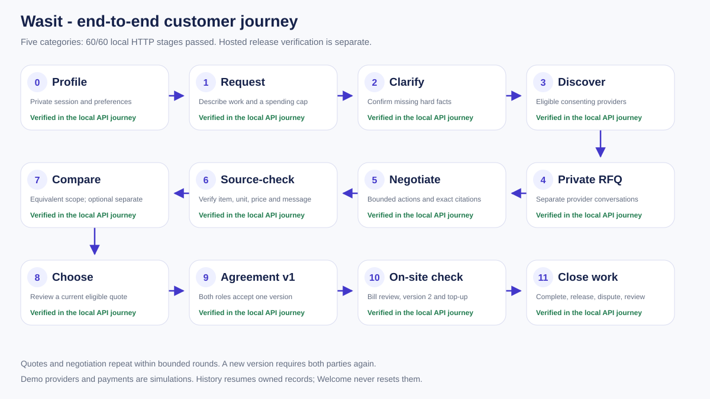
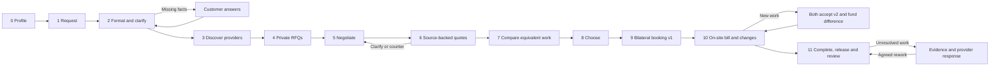

# Wasit customer journey: request to settled work

Recorded on 7 November 2026. Wasit has **twelve customer stages, numbered 0-11**. The journey starts with a customer profile, helps the customer compare suitable offers, and ends with agreed work, an explicit bill/change decision, and a recorded outcome. Optional work stays outside the committed price until both parties approve a new agreement version.

The complete journey has been rehearsed through actual local HTTP for all five service categories. Two additional AC rehearsals used OpenAI with rules fallback. These are business-flow checks against synthetic providers and a simulated ledger; they are not evidence of real provider fulfillment, real payment processing or perfect model accuracy.

## The flow

[Open the flow diagram directly](12-pipeline.svg)



If the Markdown viewer does not render diagrams, the SVG link above opens directly without an extension.



A missing reply, rejected model answer or incomplete price does not approve work. Choosing a quote creates a draft. An agreement becomes active only after both roles accept it. A new active version is funded separately.

## Stage overview

The code status below describes implementation in the current working tree, separately from deployment and real-world availability. The connected local HTTP journey passed for all five categories. Neon Free is connected; the public production AC rehearsal passed all twelve stages. Pending revisions are identified explicitly.

| # | Customer stage | Current code status | What is implemented and checked | Remaining real-world gap |
|---|---|---|---|---|
| 0 | Profile | Implemented - profile, account/session and ownership checks. | Private name, default area/category and price/schedule/trust weights. Demo sessions work; optional registration/login preserves identity and owned work. | Named email is not represented as verified. |
| 1 | Request | Implemented - owned requests and history. | A customer describes a service need. The request belongs to that customer and appears in their history. | Customer voice input is not connected. |
| 2 | Format and clarify | Implemented - full-page one-question interview and final explicit confirmation. | Five supported categories; explicit location, schedule and maximum budget. Up to three questions per server batch; one visible question per UI step. A repeated answer submission reuses the same owned child request. | Broader real-language coverage needs independent evaluation. |
| 3 | Discover providers | Implemented - bounded eligibility and discovery. | Category, consent, distance/radius and opening-hour checks; at most five provider branches. | Directory businesses and reputation data are synthetic. |
| 4 | Send private RFQs | Implemented - private branch RFQs and invitation access. | Separate conversations; only service scope, area and schedule are sent. Human invitation links use a separate bearer role. | No live WhatsApp or voice transport. |
| 5 | Negotiate | Implemented - request-specific model selection, idle-safe apply and preserved history. | Ask missing costs, counter only from permitted facts/targets, ask permitted terms, or close. Customer takeover and explicit process calls control progress. | Actual commercial provider negotiations have not been measured. |
| 6 | Build sourced quotes | Implemented - negation/conditional safeguards and complete-message source revalidation. | Item, unit, quantity, price and exact provider message are checked. Missing or invalid terms remain unresolved; optional work is excluded from the fixed total. | Provider audio/image quotation extraction is not connected. |
| 7 | Compare equivalent work | Implemented - equivalent-scope ranking and advisory separation. | Complete quotes are grouped by equivalent scope, quantity, location and time. Customer priorities determine ranking. Advisory context and optional scenarios remain separate. | Price observations do not establish a final all-in market price; insufficient data remains visible. |
| 8 | Choose | Implemented - stale/source checks and draft creation. | Current quotation, processed provider messages, scope, base quantity and appointment are checked again. Selection creates a draft. | Public production AC selection/review passed; real commercial availability remains unmeasured. |
| 9 | Book with bilateral version 1 | Implemented - sourced warranty, bilateral activation and separate simulated hold. | Submit, customer acceptance with private-cap acknowledgement, and provider acceptance of the same public terms. Version 1 becomes active; simulated funding is a separate action. | Real payment/escrow and commercial booking integration are outside the build. |
| 10 | Check the on-site bill and agree changes | Implemented - confirmed bill check, versioned changes and simulated top-up. | Manual or confirmation-only image preview, version-bound bill checks, explicit new-work proposal, sufficient new limit, bilateral version 2 and a separate top-up. Version 1 stays immutable. | Real bill-image coverage is unmeasured beyond a small synthetic image check. |
| 11 | Complete, resolve and close feedback | Implemented manual close; partial - recurring hosted 72-hour release executor. | Provider completion, customer confirmation, exact simulated release, settled review/provider reply, and version-bound dispute/evidence/rework paths. History resumes the final agreement. | No operational mediator or real settlement service. Recurring hosted auto-release execution is not deployed. |

## What the customer does at each stage

### 0. Set a profile

Welcome leads to profile setup before the in-app composer. The customer provides a display name and service area and can select a default category and priorities. Registration is optional; a demo session is sufficient to begin. When a demo customer registers, their existing identity, profile and requests are retained.

The runner saves a profile, optionally registers, logs out and logs back in, then verifies that the same customer and profile return. It creates a different owner for each service journey.

### 1. Describe the need

The customer writes a natural-language request. Their maximum budget stays private. An approximate amount is not silently treated as a spending limit, and a target can be used publicly only with explicit permission.

The rehearsal deliberately starts with a category and an incomplete description, so the next stage must ask for hard facts instead of inventing them.

### 2. Confirm missing facts

The composer first opens the full-page category interview: exact quantity and two optional context questions, one per step. Back preserves answers; the final fact summary is editable. The formatter creates a structured job or asks for missing location, appointment and maximum budget. The customer supplies the answers. A clarified request is a new child of the original; retrying the same clarification does not create duplicate children.

The job becomes ready only after the required facts are explicit. The runner verifies an explicit cap and an unauthorized-by-default public target.

### 3. Find suitable providers

Wasit selects providers that offer the category, consent to requests and match the requested service area and opening hours. Each selected provider gets its own branch. A contact cap bounds the search.

The rehearsal checks the branches against the category directory and includes one human invitation branch alongside labeled simulated providers. Directory eligibility does not claim that a real technician has accepted a job.

### 4. Ask each provider privately

The RFQ states the service, quantity, area, appointment and required cost details. It excludes the customer's identity and private spending limit. A provider sees only its own conversation and public agreement information.

The runner opens the separate human invitation through HTTP, checks the private-data projection and confirms that its bearer cannot enter the customer's request route. The unanswered human branch later follows the timeout path.

### 5. Negotiate within the customer's authority

Wasit can clarify missing costs, cite an eligible same-scope offer or an explicitly authorized target, ask an allowed term once, or close. The server computes what is allowed and renders factual outgoing text. The customer can take over a conversation without the agent guessing personal or technical facts. Confirmed transport changes remain priced lines; warranty duration and full source are preserved into the bilateral public terms. Unknown or conditional benefits are not promoted into promises.

A clear provider question about an unknown brand/model, capacity, inverter, access/floor, photo, serial number or private budget pauses automatic replies. Taking over preserves the raw question; an explicit customer reply clears it, and handing control back resumes the policy. The pending question removes quotation readiness and blocks selecting or proposing changed work, while an already accepted agreement remains unchanged. Ordinary price-acceptance proposals do not trigger this pause.

The topbar provides a context-specific OpenAI model selector, including GPT-5.4 Nano (Fast). Editing pauses new automatic actions while an in-flight action finishes; an explicit Apply changes future request actions only. The original configuration, earlier events, bill model and account defaults remain unchanged. Concurrency and revision conflicts keep the selected draft available for review.

Progress is driven by authenticated, bounded POST processing. A page read does not run hidden negotiation. In the rehearsal, scripted branches finish their bounded turns and a virtual clock advances the unanswered human branch past its persisted ninety-second deadline.

### 6. Turn replies into trustworthy cost lines

Each line retains a provider message ID and exact source snippet. Item, supported unit, quantity and price must agree with that source. An included item costs zero only when the provider says so. Unknown fees stay unknown.

The runner checks source ownership and arithmetic for every quotation. Fixed totals include the quoted fixed scope only; possible refills, parts or other optional work are not automatically added. A changed but invalid item statement cannot preserve a stale ready price.

### 7. Compare what is actually comparable

A customer compares complete equivalent work. All provider outcomes remain visible with status and reasons; incomplete or unanswered branches have no enabled Review action. A cheaper quote for fewer units or a different appointment cannot win the requested scope by accident. Scores use the customer's price, schedule and trust priorities.

Published price context and optional-cost planning help the customer ask better questions. They do not change ranking, diagnose a fault, authorize extra work or increase the customer's cap. The rehearsal reads both views and verifies that the comparison remains unchanged.

### 8. Choose a quote and inspect the draft

The customer selects a branch and exact quote revision. The service checks ownership, category/scope, base quantity, appointment, arithmetic and pending provider messages again. Posting an ID directly cannot bypass those checks.

The result is a draft containing fixed, included and optional lines. It is not yet a booking, an accepted change or a payment.

### 9. Book version 1 with both parties

The customer submits the draft, reviews the exact terms and acknowledges their private limit. The provider separately accepts the same public terms. One acceptance alone does not activate the agreement.

The accepted terms and their digest remain immutable. The provider projection excludes the private limit and acknowledgement. The rehearsal then holds the version-1 committed amount in the labeled simulation ledger and repeats the action to verify that funds are not counted twice.

### Payment implementation status

Payment is implemented as an explicitly labeled simulation. No real payment gateway, bank transfer or escrow custody is connected.

| Payment step | Current code status | Behavior |
|---|---|---|
| Initial hold after bilateral v1 acceptance | Implemented; local and public AC journey verified | Explicit customer action records the committed amount once. Acceptance itself does not move funds. |
| Additional funding after bilateral v2 acceptance | Implemented; local and public AC journey verified | A separate action records only the approved difference; retries do not duplicate the top-up. |
| Completion and customer-confirmed release | Implemented; local and public AC journey verified | Provider marks the funded current version done; customer confirmation releases the exact amount once. |
| Dispute and agreed rework | Implemented; local and public AC journey verified | Funds remain held while disputed; accepted rework requires renewed completion before release. |
| Automatic release after 72 hours | Partial | Eligibility/settlement service exists; a recurring hosted executor is not deployed. Reads never trigger release. |
| Real payment/escrow | Outside current product scope | No real money is held, transferred or charged. |

### 10. Check the bill, then agree version 2 if needed

At the site, the customer confirms manually entered rows or an editable image-reading preview. A bill check compares the rows with the active version and can flag an increased price, a charge for an included item or unapproved new work. Repeated quantities are aggregated before comparison.

In every category, the rehearsal checks a changed bill against v1, rejects extra work under an insufficient old cap, and submits an explicit sufficient new cap with a provider-sourced optional item. Version 1 stays active until both parties accept version 2. Its old terms and digest are preserved.

Version 2 does not fund itself. The runner rejects completion before top-up, rejects a bill tied to the old active version, checks the approved v2 bill, and pays the precise difference once.

| Rehearsed category | v1 committed total | Explicit old cap | v2 committed total | Separate top-up |
|---|---:|---:|---:|---:|
| AC service | Rp120,000 | Rp160,000 | Rp340,000 | Rp220,000 |
| Washing-machine service | Rp180,000 | Rp230,000 | Rp480,000 | Rp300,000 |
| Plumbing | Rp150,000 | Rp200,000 | Rp250,000 | Rp100,000 |
| Electrical work | Rp160,000 | Rp210,000 | Rp320,000 | Rp160,000 |
| Home cleaning | Rp230,000 | Rp280,000 | Rp430,000 | Rp200,000 |

These are synthetic rehearsal offers, not market reference prices. Every demonstrated new total exceeds the original cap; the new limit is an actual increase.

### 11. Finish, resolve a problem and record the outcome

The provider marks the funded current version complete. Reading the agreement keeps funds held. Customer confirmation releases the exact simulated amount once; retries do not duplicate the release.

The same rehearsal includes an unresolved-work branch before final settlement: the customer opens a dispute, adds evidence, and cannot release funds while the dispute is open. The simulated provider accepts rework. Funds stay held, completion must be marked again, and only then does the customer confirm release.

A settled review and provider reply are saved. The customer's history resumes the correct v2 agreement and its released lifecycle. The current history row reports the agreement state as `locked`; the resumed agreement supplies the settled outcome. It is not described as a released-history status that the row does not yet expose.

## Actual end-to-end evidence

The runner starts an isolated in-memory SQLite backend and uses actual HTTP, cookies, CSRF and separate provider actions. It does not edit agreement/payment tables to force the business outcome, use another customer's records, reset other users, or call a model in rules mode.

| Recorded run | Connected stages | Stage invariants | HTTP requests | Observed interval |
|---|---:|---:|---:|---:|
| Rules, five categories | 60/60 | 260/260 | 330 | 2.925 seconds |
| OpenAI AC journey, first run | 12/12 | 52/52 | 64 | 46.479 seconds |
| AC capped fallback rehearsal | 12/12 | 52/52 | 66 | 69.560 seconds |
| Public production AC journey | 12/12 | 52/52 | 64 | 138.589 seconds, including real human-reply deadline |

The five rules journeys also passed five owner-history isolation checks. Every journey reached bilateral v2, a funded change, dispute/rework, final release, review and provider reply. Passing workflow checks is not a claim of perfect extraction quality or production availability.

The first AC run made sixteen OpenAI calls: one formatter, five provider simulations, five extractions and five buyer decisions. All sixteen returned completed HTTP 200 responses. Its recorded events used twelve model engines and six rules engines; rules still own arithmetic and agreement/payment decisions.

A separate eight-attempt run exercised timeout, transport failure and credit-cap continuation. Two requests completed, one was aborted at the model deadline, and five had transport errors. The persisted model-attempt counter reached 8/8. The journey still completed through verified rules fallback, recording one model event, thirty-one rules events, six rules quote fallbacks and eleven explicit rejection events. The formatter also retained rules with one rejection event.

Across both live rehearsals, the authorized additional cap was **24 network attempts**. Completed responses reported **8,752 input tokens and 2,058 output tokens**, totaling **10,810 tokens**. Usage for failed/aborted requests was unavailable; no claim is made that those attempts were unbilled. No non-OpenAI provider was used.

Reproduce the rules journey with:

```sh
node --disable-warning=ExperimentalWarning scripts/e2e-pipeline.mjs
```

An explicitly authorized live run uses the ignored environment file:

```sh
node --disable-warning=ExperimentalWarning --env-file=.env scripts/e2e-pipeline.mjs --live
```

`--call-cap=8` runs the same AC journey with a smaller model-attempt ceiling. The hard maximum is 24. Reports are written to ignored `results/pipeline-e2e-rules.json` and `results/pipeline-e2e-live.json`; the initial sixteen-call trace was preserved as `results/pipeline-e2e-live-first.json`. Reports contain stage matrices, exact invariant flags, latencies, HTTP totals, actual engine counts and sanitized model usage. They contain no passwords, cookies, invitation tokens or authorization headers.

## Local versus hosted status

The integrated public release is Ready at https://wasit-id.vercel.app. The current unauthenticated checks return HTTP 200 for the page, health with AI ready and session restoration; unknown API routes return JSON 404. Neon Free is provisioned and connected. A fresh isolated production AC journey passed persisted business actions, including login/profile, bilateral v1/v2 acceptance, bill checking, simulated hold/top-up, dispute/rework, exact release, review and resumed history. It performed 64 HTTPS requests and 52 invariant checks in 138.589 seconds, including the real human-reply deadline. Runtime models were configured; per-call token usage was not measured for this hosted run. The earlier storage_not_configured failure belongs to the previous deployment.

Storage provisioning, secure deployment configuration and a real hosted multi-request rehearsal are **cross-cutting release requirements**, not additional customer stages. The local HTTP evidence alone does not close hosted verification or establish real PostgreSQL race/latency behavior.

The remaining commercial gaps are verified participating providers, actual communication transport, real payment/escrow, an operational dispute mediator and broader bill/language evidence. Browser layout verification is separate from this HTTP business rehearsal.

## Bounded execution and authority appendix

- The customer owns the request, private cap, public-target permission, version acceptance, bill confirmation and review. A model cannot supply those permissions.
- Provider statements own quoted prices and optional-work candidates. Exact source, unit and quantity checks precede ranking or agreement creation.
- The server owns eligibility, arithmetic, version/digest matching, both role acceptances and the simulation ledger. Accepted versions and acceptances are immutable.
- Tasks persist source keys, request generation, deadlines and leases. At most two tasks run globally and one per branch. Expired claims recover; archive/reset prevents late mutations. A task lease lasts 45 seconds.
- A human reply deadline is persisted at 90 seconds. The runner advances an injected clock for this case; the reported seconds are not a real ninety-second waiting trial.
- Model calls have a separate shared concurrency cap of two. The current default deadline is 12 seconds, configurable up to 20 seconds, with leases lasting two seconds longer. There are no automatic model retries.
- Production model attempts have a shared persisted daily cap, default 500 per UTC day. The live runner uses its own smaller persisted cap before network use.
- A completed funded version can qualify for simulated release after 72 hours without an unresolved dispute or pending change. The explicit settlement service exists; a recurring hosted executor is not deployed. GET requests never settle money.
- Advisory reference bands need the same item, unit and narrow scope, with at least five accepted observations from three publishers. Missing evidence remains insufficient data; it is not filled from synthetic offers.

## Latest public fast-model rehearsal

The public AC journey was repeated on the 9815a42 release with GPT-5.4 Nano explicitly selected for request actions. It passed 12/12 stages and 52/52 invariant checks across 65 HTTPS requests in 133.923 seconds, including the real human-reply deadline. Recorded events used 10 model engines and 9 rules engines; network model-call counts and token usage were not separately measured. This verifies the connected business journey, not perfect extraction or a latency SLA.

The final local release suite passes 219 automated tests, 16 contract fixtures and the production build. Two subsequent conservative warranty guards additionally keep paid warranty upgrades and parts-only exclusions from becoming an unqualified free service warranty. Their focused regressions preserve accepted history. Provider invitation renewal is an explicit authenticated owner action; a CSRF failure cannot mint a new grant.
